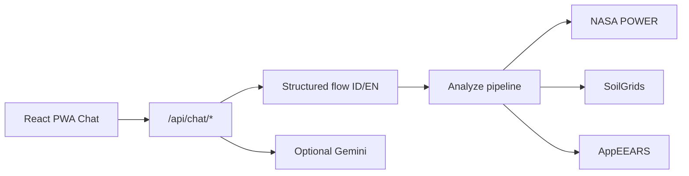

# TaniPilot (Wiweka)

Chat-first crop rotation advisor for Indonesian farmers. Petani cukup chat lokasi dan prioritas — TaniPilot mengambil data NASA (cuaca, tanah, vegetasi, kelembapan) dan memberi rekomendasi rotasi tanam dengan **timestamp sumber data** di setiap angka.

Challenge brief: [description.md](description.md) · Product vision: [ideas_2.md](ideas_2.md)

## Fitur

- **Chat UI** (ID/EN) — alur terstruktur: lokasi → tanaman terakhir → prioritas → hasil
- **GPS via PWA** — tombol "Pakai lokasi saya" memakai geolocation perangkat
- **Data provenance** — setiap kartu cuaca/tanah/satelit menampilkan sumber, waktu diambil, periode, resolusi
- **LLM opsional (Gemini)** — tanya bebas setelah analisis selesai (butuh `GOOGLE_AI_STUDIO_API_KEY`)
- **Mesin skor** — POWER + SoilGrids + AppEEARS (MODIS NDVI, SMAP) + crops.json



## Jalankan lokal (.venv, tanpa Docker)

### Backend

```bash
cd backend
python3 -m venv .venv
.venv/bin/pip install -r requirements.txt
cp .env.example .env
.venv/bin/uvicorn app.main:app --reload
```

API: http://localhost:8000 · Docs: `/docs`

### Frontend

```bash
cd frontend
npm install
npm run dev
```

App: http://localhost:5173 — Vite mem-proxy `/api` ke backend.

### `.env`

```
EARTHDATA_USERNAME=your_username
EARTHDATA_PASSWORD=your_account_password   # bukan JWT token
GOOGLE_AI_STUDIO_API_KEY=                  # opsional, untuk chat bebas (Gemini)
GOOGLE_AI_STUDIO_MODEL=gemini-2.5-flash
CORS_ORIGINS=http://localhost:5173
```

### PWA

Build production lalu serve HTTPS (atau localhost untuk dev):

```bash
cd frontend && npm run build && npm run preview
```

Di mobile: **Add to Home Screen**. GPS membutuhkan HTTPS atau localhost.

### Tests

```bash
cd backend && .venv/bin/python -m pytest
```

## API Chat

```bash
# Buat session
curl -X POST http://localhost:8000/api/chat/session -H 'Content-Type: application/json' -d '{"lang":"id"}'

# Kirim lokasi preset
curl -X POST http://localhost:8000/api/chat/session/{id}/message \
  -H 'Content-Type: application/json' \
  -d '{"action_id":"preset_klaten"}'
```

Alur quick-reply: `confirm_yes` → `crop_rice` → `prio_balanced` → polling session sampai `step=free_chat`.

REST lama (`POST /api/analyze`, `GET /api/tasks/{id}`) tetap tersedia.

## Provenance

Setiap `ClimateSummary`, `SoilSummary`, `VegetationSummary`, `MoistureSummary` memiliki field `meta`:

```json
{
  "source": "NASA POWER",
  "fetched_at": "2026-10-02T14:32:00Z",
  "period_start": "2020-01-01",
  "period_end": "2024-12-31",
  "resolution": "0.5° × 0.625° grid (~50 km)",
  "cached": false,
  "disclaimer": "coarse_resolution"
}
```

## Known limitations

- AppEEARS bisa 1–2 menit; chat menampilkan progress
- SoilGrids REST kadang down → fallback profil dataran rendah
- SMAP = kelembapan permukaan, bukan root zone
- LLM hanya aktif jika `GOOGLE_AI_STUDIO_API_KEY` diset (Google AI Studio / Gemini)
- Komponen dashboard lama ada di `frontend/src/components/legacy/`
